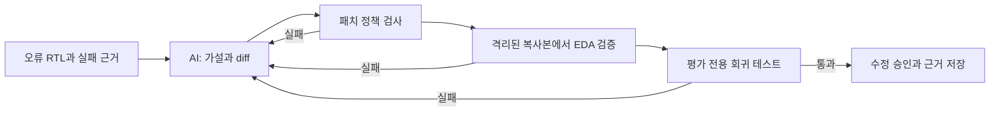

# SemiDebug Agent

OpenAI API 모델이 RTL 오류의 원인과 최소 수정안을 제안하면, **독립 EDA 검사와 모델에 보이지 않는 회귀 테스트가 통과한 수정만 승인하는** 연구 프로토타입입니다.



## 왜 필요한가

LLM이 만든 RTL 패치는 문법상 맞아도 동작이 틀리거나 기존 기능을 깨뜨릴 수 있습니다. SemiDebug는 AI에게 진단과 후보 패치만 맡깁니다. 성공 판정은 Icarus/VVP 시뮬레이션, Verilator 린트, Yosys 구조 검사, 평가 전용 회귀 테스트와 원본·테스트 SHA256 검사로 결정합니다. 실패한 패치는 원본에 누적하지 않고, 검증 근거를 다음 시도에 전달합니다. [설계 경계](docs/ARCHITECTURE.md).

## 실제 측정 결과

| 평가 | 대상 | 최종 수정 | 첫 시도 | 확인할 점 |
|---|---:|---:|---:|---|
| 외부 ChipBench | 사전 선정 12건 | **6/12** | 1/12 | semantic retry 성공 3건, 최종 실패 6건 포함 |
| 내부 feedback loop | 자체 RTL 오류 30건 | **29/30** | 22/30 | 최대 3회, 회귀 테스트 소스를 모델 입력에서 분리 |
| 내부 one-shot | 같은 30건 | **23/30** | 23/30 | 별도로 실행한 독립 측정 |

내부 feedback loop에서 재시도로 통과한 7건은 모두 **diff 형식 오류 복구**였습니다. 외부 사례에서는 공식 회귀 검증이 후보를 거절한 뒤 다른 후보가 통과한 semantic retry 3건을 관찰했습니다. 수치와 실패 사례, 선정 규칙은 [최종 평가 보고서](docs/EVALUATION.md)에서 확인할 수 있습니다.

## 60초 데모

[uv](https://docs.astral.sh/uv/getting-started/installation/)와 실행 중인 Docker가 필요합니다. ZIP을 풀어 사용하면 저장소 복제 도구는 필요하지 않습니다. 프로젝트 폴더에서:

```bash
./scripts/bootstrap.sh
./scripts/run_demo.sh --scripted
```

기본 데모와 scripted 데모는 모델에 보이는 target 테스트와 평가 전용 hidden regression 소스가 분리된 FIFO 사례를 사용합니다. scripted 데모는 알려진 패치를 사용하더라도 EDA와 hidden regression을 매번 실제 실행하며, AI 성능 측정에는 포함하지 않습니다. `./scripts/run_demo.sh --replay`는 기록된 semantic retry 사례를 보여줍니다.

실제 AI 데모는 호스트의 `.env`에 설정된 OpenAI API 키와 모델을 사용합니다.

```bash
./scripts/doctor.sh
./scripts/run_demo.sh
```

API 호출은 사용한 토큰에 따라 과금됩니다. [자세한 실행 방법](QUICKSTART.md) · [OpenAI API 설정](docs/OPENAI_API.md).

## 근거와 재현

- [내부 one-shot 대 feedback loop 비교](results/final/internal/comparison.md)
- [외부 12건 전체 결과](results/final/external/chipbench/evaluation.md)와 [사전 고정 선정 규칙](docs/EXTERNAL_BENCHMARK_PROTOCOL.md)
- [실제 semantic retry](results/final/evidence/semantic_retry/report.md)와 [최종 실패](results/final/evidence/final_failure/report.md)
- [실행 검증 보고서](VERIFICATION_REPORT.md)와 [기계 판독 결과](results/final/verification/verification_summary.json)
- [포트폴리오 근거](PORTFOLIO_EVIDENCE.md) · [제출물 안내](SUBMISSION_GUIDE.md)

최종 내부 데이터셋은 `benchmark_v2/`, 실행 코드는 `src/semidebug/`, 모델과 독립된 정답 및 평가 코드는 `evaluator/`에 있습니다. 최종 API 결과는 `results/final/`에 있습니다. 외부 원본 데이터는 ZIP에 넣지 않고 [입력 파일 해시가 기록된 선정 목록](external/chipbench/selection_manifest.json)과 가져오기 스크립트를 제공합니다.

경로에 남은 `v2`는 저장된 실행 기록의 참조를 깨뜨리지 않기 위한 내부 이름입니다. 제출 제품은 이 최종 상태 하나입니다.

이 프로젝트는 소형 RTL을 대상으로 한 연구·포트폴리오 결과입니다. 유한한 테스트 통과가 형식적 정확성이나 실제 silicon 검증을 뜻하지 않습니다. 외부 12건은 작은 표본이며 모델의 사전학습 노출 여부는 확인할 수 없습니다. [한계](docs/LIMITATIONS.md) · [외부 소프트웨어와 데이터 출처](docs/THIRD_PARTY.md). MIT 라이선스.
