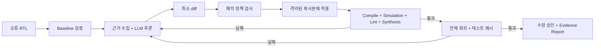

# SemiDebug Agent

RTL 오류의 원인을 추론하고 최소 패치를 제안한 뒤, **실제 EDA 도구와 변경 불가능한 테스트를 통과한 수정만 승인하는** CLI 프로토타입입니다.

## 현재 결과

- 자체 제작 RTL 6종: counter, FIFO, round-robin arbiter, FSM controller, ALU, pulse detector.
- 오류 사례 **30개**: 공개 24개 / holdout 6개. 정상 버전은 모든 검증·회귀 테스트를 통과하고, 오류 버전 30개 모두 실제 실패를 재현했습니다.
- 단위·EDA 통합·스크립트 기반 E2E 테스트 **86개 통과**.
- 알려진 정답 패치를 공급한 **파이프라인 검증 30/30 통과**. 이는 AI 수리 성공률이 아닙니다.
- **실제 LLM 데모·AI 벤치마크는 API 키 미설정으로 미실행**입니다. AI 성공률·토큰 비용은 측정하지 않았습니다. [상태 기록](docs/issues/ISSUE-001-live-credentials.md)

## 왜 필요한가

LLM이 제시한 코드가 컴파일되는 것과 원래 기능을 유지하며 오류를 고치는 것은 다릅니다. SemiDebug는 추론, 최소 변경, 외부 검증, 실패 피드백을 연결하고 원본·테스트 무결성을 확인합니다. 근거 로그와 diff가 함께 남으므로 수리가 실패한 이유도 확인할 수 있습니다.

## 동작 방식



원본 소스는 직접 변경하지 않습니다. 승인된 RTL은 실행 결과의 `final/rtl/`에 저장합니다. 모든 재시도는 원래 baseline을 기준으로 하며, 최대 3회·동일 패치 반복·연속 금지 패치 등에서 안전하게 종료합니다.

## 빠른 실행

필요 도구: Git, [uv](https://docs.astral.sh/uv/getting-started/installation/), 실행 중인 Docker.

```bash
git clone https://github.com/CodingBot000/semidebug_agent.git
cd semidebug_agent
./scripts/bootstrap.sh
./scripts/run_demo.sh --scripted
```

`--scripted`는 미리 정한 패치를 사용하지만 Icarus·Verilator·Yosys와 회귀 테스트는 **매번 실제 실행**합니다. API 호출은 없습니다.

기록만 읽으려면:

```bash
./scripts/run_demo.sh --replay
```

화면에 `RECORDED RUN`이 표시되며 도구를 새로 실행하지 않습니다.

실제 AI 실행:

```bash
cp .env.example .env
# .env에 OPENAI_API_KEY, OPENAI_MODEL 설정
# 필요하면 OPENAI_BASE_URL 및 SEMIDEBUG_JSON_MODE=true 설정
./scripts/run_demo.sh
./scripts/run_benchmark.sh benchmark/public
./scripts/run_benchmark.sh benchmark/hidden
```

키는 `.env`에만 보관하고 Git에 추가하지 않습니다. 모델명은 사용할 provider에서 지원하는 값으로 지정합니다. 호환 provider가 strict JSON schema를 지원하지 않을 때만 JSON mode를 명시적으로 켭니다. 가격은 설정하지 않으면 `unknown`으로 남습니다.

## 검증 정책

| 단계 | 도구 | 승인 조건 |
|---|---|---|
| Compile | Icarus 11.0, `-g2012` | 종료 코드 0 |
| Simulation | VVP `-N` | 종료 코드 0 + immutable testbench 완료 표식 |
| Lint | Verilator 5.006 | 오류 및 중요 warning 없음 |
| Synthesis sanity | Yosys 0.23 | hierarchy/proc/opt/check -assert 통과 |
| Regression | 별도 seed 17, 103 | 더 긴 시나리오 모두 통과 |
| Integrity | SHA256 | 원본 및 immutable 파일 보존 |

최신 upstream 대신 고정된 Debian 도구 버전을 사용합니다. Python 3.12.14와 기반 이미지 digest, 잠긴 Python 의존성으로 재현 환경을 제공합니다. [조사](docs/RESEARCH.md) · [결정 근거](docs/DECISIONS.md)

## CLI 및 테스트

```bash
uv run semidebug --help
./scripts/doctor.sh
make test             # 호스트 단위 테스트
make test-integration # Docker에서 정상/오류 RTL 검증
make e2e              # 실제 EDA + scripted provider
make test-all
make lint
make package
```

네이티브 EDA 도구가 있으면 `uv run semidebug fix <case-directory>`를 직접 실행할 수 있습니다. 입력 형식은 [예제 manifest](examples/fifo_off_by_one/case.json)와 같습니다. 임의의 shell build 명령은 지원하지 않습니다. 각 명령은 `--help`를 제공합니다.

## 근거와 벤치마크

- [측정 범위와 결과](docs/BENCHMARK.md)
- [첫 시도 성공](results/sample_run/report.md) / [재시도 성공](results/retry_run/report.md) / [실패 사례](results/failed_run/report.md)
- [파이프라인 결과 JSON](results/benchmark_results.json) / [CSV](results/benchmark_results.csv)
- [정상·오류 데이터셋 검증 로그](results/dataset_audit.json)
- [포트폴리오 설명](PORTFOLIO_EVIDENCE.md)

## 구조

`src/semidebug/`는 CLI·에이전트·provider·패치·검증·리포트를 포함합니다. `benchmark/`에는 오류 사례와 변경 불가능한 테스트가 있습니다. `evaluator/`의 정상 정답과 mutation 정의는 에이전트 입력과 격리됩니다. `tests/`는 단위·통합·E2E 검증, `results/`는 실제 실행 기록, `docs/PROGRESS.md`와 `docs/ISSUES.md`는 개발 이력입니다.

## 한계

소형 자체 제작 RTL을 대상으로 한 연구·포트폴리오 프로토타입입니다. 상용 반도체 EDA, silicon 검증, physical verification, formal equivalence를 대체하지 않습니다. Yosys의 기본 SystemVerilog 지원 범위는 제한적입니다. 테스트 통과가 모든 입력에 대한 정확성 증명은 아닙니다.

현재 live API 호출과 AI 수리 성능은 검증되지 않았습니다. Holdout은 다른 mutation을 사용하지만 같은 설계 계열이므로 독립 설계에 대한 일반화 결과가 아닙니다. 임의의 악성 HDL을 안전하게 실행하는 제품이 아니며, native/live 모드는 신뢰하는 입력만 사용합니다. [실행 경계와 보안](docs/SECURITY.md)

MIT 라이선스. 외부 도구 라이선스는 [THIRD_PARTY.md](docs/THIRD_PARTY.md)를 확인하세요.
