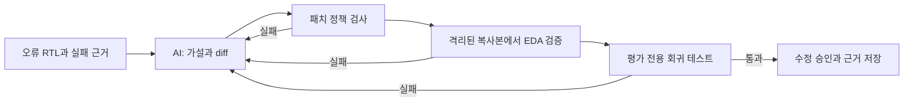

# SemiDebug Agent

AI가 RTL 오류의 원인과 최소 수정안을 제안하면, **독립 EDA 검사와 모델에 보이지 않는 회귀 테스트가 통과한 수정만 승인하는** CLI 연구 프로토타입입니다.



## 왜 필요한가

LLM이 만든 RTL 패치는 문법상 맞아도 동작이 틀리거나 기존 기능을 깨뜨릴 수 있습니다. SemiDebug는 AI에게 진단과 후보 패치만 맡깁니다. 성공 판정은 Icarus/VVP 시뮬레이션, Verilator 린트, Yosys 구조 검사, 평가 전용 회귀 테스트와 원본·테스트 SHA256 검사로 결정합니다. 실패한 패치는 원본에 누적하지 않고, 검증 근거를 다음 시도에 전달합니다. [설계 경계](docs/ARCHITECTURE.md).

## 실제 측정 결과

| 평가 | 대상 | 최종 수정 | 첫 시도 | 확인할 점 |
|---|---:|---:|---:|---|
| V2 내부, 최대 3회 | 자체 RTL 오류 30건 | **30/30** | 23/30 | 회귀 테스트 소스를 모델 입력에서 분리 |
| V2 내부, 별도 1회 실행 | 같은 30건 | **24/30** | 24/30 | 별도 실행이므로 첫 행과 동일한 모델 샘플은 아님 |
| V2 외부 ChipBench | 사전 선정 12건 | **5/12** | 2/12 | 실제 semantic retry 성공 3건, 최종 실패 7건 |

내부 최대 3회 실행에서 추가로 통과한 7건은 모두 **diff 형식 오류 복구**였습니다. 외부 사례에서는 공식 회귀 검증이 첫 후보를 거절한 뒤 다른 후보가 통과한 사례 3건을 관찰했습니다. V1의 내부 30/30은 별도의 과거 측정이며 [원본 결과](results/live_codex/summary.md)에 보존했습니다. V1과 V2의 평가 방식이 달라 성능 향상 수치로 직접 비교하지 않습니다. 수치와 실패 사례, 선정 규칙은 [V2 평가 보고서](docs/V2_EVALUATION.md)에서 확인할 수 있습니다.

## 60초 데모

Git, [uv](https://docs.astral.sh/uv/getting-started/installation/)와 실행 중인 Docker가 필요합니다. 프로젝트 폴더에서:

```bash
./scripts/bootstrap.sh
./scripts/run_demo.sh --scripted
```

기본 데모와 scripted 데모는 모두 V2 FIFO fixture를 사용합니다. 모델에 보이는 target 테스트와 평가 전용 hidden regression 소스가 분리되어 있고, 이 데모는 알려진 패치를 사용하더라도 EDA와 hidden regression을 매번 실제 실행합니다. AI 성능 측정은 아닙니다. `./scripts/run_demo.sh --replay`는 기록된 V2 semantic retry를 보여주며, V1 기록은 `--replay-v1`로 볼 수 있습니다.

실제 AI 데모는 호스트의 ChatGPT 인증을 사용합니다.

```bash
npm install -g @openai/codex@latest
codex login
./scripts/doctor.sh
./scripts/run_demo.sh
```

API 키는 기본 Codex CLI 경로에 필요하지 않습니다. 구독 사용 한도를 소비합니다. [자세한 실행 방법](QUICKSTART.md) · [CLI 설정](docs/CODEX_CLI.md).

## 근거와 재현

- [내부 one-shot 대 feedback loop 비교](results/v2/internal/comparison.md)
- [외부 12건 전체 결과](results/v2/external/chipbench/evaluation.md)와 [사전 고정 선정 규칙](docs/EXTERNAL_BENCHMARK_PROTOCOL.md)
- [실제 semantic retry](results/v2/evidence/semantic_retry/report.md)와 [최종 실패](results/v2/evidence/final_failure/report.md)
- [Git 기반 provenance](results/v2/PROVENANCE.json)와 [최신 로컬 검증 기록](results/v2/verification/verification_summary.json)
- [포트폴리오 근거](PORTFOLIO_EVIDENCE.md) · [제출물 안내](SUBMISSION_GUIDE.md)

V2 내부 데이터셋은 `benchmark_v2/`, 실행 코드는 `src/semidebug/`, 모델과 독립된 정답·데이터셋 생성 코드는 `evaluator/`에 있습니다. 외부 원본 데이터는 ZIP에 넣지 않고 [해시가 기록된 선정 목록](external/chipbench/selection_manifest.json)과 가져오기 스크립트를 제공합니다.

이 프로젝트는 소형 RTL을 대상으로 한 연구·포트폴리오 결과입니다. 유한한 테스트 통과가 형식적 정확성이나 실제 silicon 검증을 뜻하지 않습니다. 외부 12건은 작은 표본이며 모델의 사전학습 노출 여부는 확인할 수 없습니다. [한계](docs/LIMITATIONS.md) · [외부 소프트웨어와 데이터 출처](docs/THIRD_PARTY.md). MIT 라이선스.
