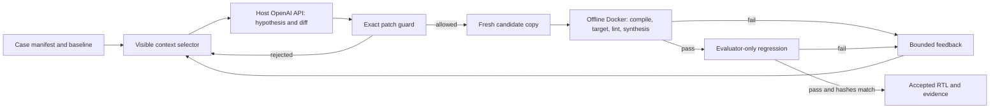

# Architecture and control boundaries

The model proposes a diagnosis and an RTL diff. SemiDebug alone applies the diff and decides whether it is accepted. The model has no validation tool access and cannot mark its own patch successful. [Diagram source](architecture.mmd).

## What crosses each boundary

| Boundary | Permitted data or action | Kept outside |
|---|---|---|
| Model request | Mutable RTL, visible target source or problem statement, baseline diagnostics, prior visible validation and bounded retry status | Gold RTL, mutation definition, external reference solution, hidden test source, detailed hidden expected output |
| Patch guard | Exact unified diff against manifest-listed RTL, at most two files and 40 changed lines | Testbench, manifest, reference files, fuzzy application, verification-bypass directives |
| EDA worker | A fresh case copy and a fixed validation mode in a network-disabled Docker container | API credentials and arbitrary manifest shell commands |
| Acceptance | Compile, target simulation, critical lint, synthesis sanity, evaluator-only regression and original/immutable SHA256 checks | Model self-assessment or a zero exit code without trusted completion evidence |

`benchmark/loader.py` validates manifest identifiers and paths. `tools/workspace.py` copies only selected case files into a temporary workspace. `context/selector.py` chooses provider-visible files; evaluator-only regression sources are deliberately absent. When a hidden regression fails, the full mismatch log stays in the local run artifact. The next model request receives only the failed gate and status, while visible tool failures can provide bounded logs. The previous diff and hypothesis remain available for retry. This preserves useful feedback without disclosing evaluator answers.

`agent/orchestrator.py` starts every candidate from the original baseline. A rejected or failing patch is never applied cumulatively to the next attempt. It stops on exhausted iterations, repeated diffs or failures, consecutive invalid patches, provider errors and infrastructure errors. The typed `PatchAttempt.retry_reason` distinguishes parse/guard repairs from compile, simulation, lint, synthesis and regression failures. The accepted RTL and exact diff are saved under `final/`; source inputs remain untouched.

Internal cases use Icarus/VVP with a trusted `SEMIDEBUG_PASS` marker, Verilator lint, Yosys structural checks and a separate hidden regression testbench exercised with two seeds. The ChipBench adapter verifies frozen upstream input hashes, extracts buggy `TopModule` and keeps `RefModule` and the official test evaluator-only. It requires the official `Mismatches: 0 in N samples` result in addition to compile, lint, synthesis and integrity gates. External test source is never sent to the provider.

Each run writes `run.json`/`result.json`, `events.jsonl`, baseline logs, per-attempt hypothesis/diff/validation, final RTL and regression evidence, and `report.md`. Provider failures do not dump raw API bodies or credentials. The process is sequential so the complete decision path can be inspected. Native subprocesses are for trusted HDL; see [execution boundaries](SECURITY.md).
